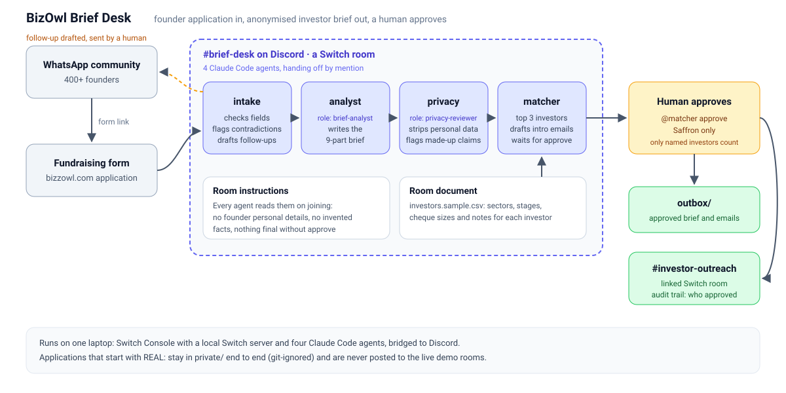

# BizOwl Brief Desk

**Four AI agents and one human turn a founder's funding application into an anonymised, investor-ready brief, right inside a Discord channel. About 4 minutes of agent time, and nothing goes out until a person approves it.**

Built by team **Room_Mates** with [Switch](https://www.switchagents.ai/) during the [Flip the Switch hackathon](https://www.wemakedevs.org/hackathons/switch) (WeMakeDevs × DevTools Academy × Switch), 4 to 7 November 2026.

| | |
| --- | --- |
| 👥 **Team** | Room_Mates: Anurag Kumar and Abhigya |
| 🏆 **Track** | Track 1: Best Business Workflow |
| 📺 **Demo video** | [Demo Video](https://www.youtube.com/watch?v=08uIkZkuxsc)
| 🤖 **Agents** | 4 Claude Code agents: `intake`, `analyst`, `privacy`, `matcher` |
| 💬 **Team chat** | Discord, through Switch's Discord bridge |
| 🧩 **Switch features** | Rooms, room instructions, roles, a room document, linked rooms, permissions, human approval, a template |
| 🔁 **Recreate it** | One file: [`templates/bizowl-brief-desk.yaml`](templates/bizowl-brief-desk.yaml). Works with Switch's built-in Mattermost too, no Discord needed |



### For the judges

| What you're looking for | Where to find it |
| --- | --- |
| **Use of Switch:** is it central, and would it stop working without it? | [How Switch is used](#how-switch-is-used) and [What breaks without Switch](#what-breaks-without-switch) |
| **Technical execution:** does it run, can you reproduce it? | [Run it yourself](#run-it-yourself): one template creates all 4 agents and 4 rooms. Sample inputs in [`samples/`](samples/applications/), real outputs in [`examples/`](examples/outputs/) |
| **Creativity and impact:** does it solve a real team's problem? | [Why we built this](#why-we-built-this) and [What it caught in testing](#what-it-caught-in-testing), including a private run on a real BizOwl application |
| **Presentation** | The demo video above and the [demo walkthrough](#demo-walkthrough) |

---

## Why we built this

[BizOwl](https://bizzowl.com) helps early-stage founders in India's Tier-2 and Tier-3 cities raise money. Founders apply through our [fundraising form](https://bizzowl.com/startup-fundraising), which we share in our 400+ member WhatsApp community. For every application, our team writes a one-page brief from an investor's point of view, with the founder's name and contact details hidden so investors judge the startup first.

Doing that by hand means reading a long application, cross-checking every number, scrubbing every name and link, and then working out which investors might care. It is slow, and it is easy to get wrong in ways that cost trust:

- a phone number, a co-founder's name or a LinkedIn link slips into a brief that was meant to be anonymous
- a red flag goes unnoticed, like a startup calling itself "Scaling" while raising a pre-seed round, or asking for less money than it makes in four months
- a startup gets pitched to an investor whose stage or cheque size doesn't fit

We wanted the slow parts done by agents, the judgement calls kept with people, and all of it happening where our team already talks.

## What it does

A team member pastes an application into a Discord channel. Four agents pass it along, one job each, and every hand-off is a message the whole team can see.

| Agent | Room role | Job |
| --- | --- | --- |
| **intake** | | Checks every field on BizOwl's fundraising form. If something is missing, drafts a short WhatsApp message for the team to send the founder. Lists **"Questions an investor will ask"**: numbers that disagree, a stage that doesn't match the round, a raise that doesn't fit the revenue, vague claims. Moves personal details into a confidential field. |
| **analyst** | `brief-analyst` | Writes a 9-part brief: header line, snapshot, problem and customer, solution, traction, market (labelled as the founder's estimate), team, the raise, investor questions, and what is still to confirm. Uses only facts from the application. |
| **privacy** | `privacy-reviewer` | Strips founder, team, mentor and advisor names, phone numbers, emails, LinkedIn and pitch deck links. Keeps the state, drops the city. Checks every number in the brief against the application and flags anything that was added. |
| **matcher** | | Picks the top 3 investors from the room's investor list, explains each fit (and any stage or cheque mismatch), drafts an intro email for each, then **waits**. |

Then a person decides. `@matcher approve` approves all three, `@matcher approve Saffron only` approves one. Only then does matcher save the brief and the approved emails to `outbox/` and post them in the linked outreach room, with a note of who approved them. Unapproved drafts are never saved.

## Demo walkthrough

This is the run in our demo video, using the fictional application in [`samples/applications/khetora.txt`](samples/applications/khetora.txt):

1. **The application comes in.** A team member pastes it into `#desk-live`, starting with `@intake`.
2. **Something's missing.** The founder left out use of funds. Intake says so and drafts a WhatsApp message asking for it.
3. **A human answers.** The team member replies in intake's thread with the use of funds ([`khetora-followup.txt`](samples/applications/khetora-followup.txt)).
4. **Red flags, caught early.** Intake lists the questions an investor would ask straight away: 45 FPOs in one answer and 120 in another, "Scaling" but raising pre-seed, Rs 30 lakh asked against Rs 8 lakh monthly revenue, and a two-week close.
5. **The brief.** Analyst takes its `brief-analyst` role and writes the brief.
6. **The privacy pass.** Privacy takes its `privacy-reviewer` role and removes the founder's name, the CTO's name, the mentor, the LinkedIn URL and the pitch deck link. It keeps Madhya Pradesh and drops Indore.
7. **The matches.** Matcher suggests agritech investors with a reason for each, flags one whose usual stage is later than this round, drafts three emails, and stops.
8. **The human call.** The team member types `@matcher approve Saffron only`. Only the Saffron email is saved and posted to `#outreach-live`. The other two drafts are dropped.

## What it caught in testing

Every one of these happened in our test runs on the fictional applications in [`samples/applications/`](samples/applications/):

- **Made-up details.** The analyst wrote that the CTO built "2 apps with 50k+ downloads each". The application never said "each". Privacy caught it, plus two other claims that weren't in the application, and marked all three "to confirm". (KisanKart)
- **Personal data hidden in free text.** A founder put her name, email, phone and LinkedIn inside her answers and asked to hide the company name. Privacy removed all of it, and matcher even named the output files `healthtech-tier2` instead of using the company name. (MediSaathi)
- **Credit is not revenue.** Rs 1.1 crore of credit tracked through a kirana app could easily read as revenue. Intake flagged it, and every agent after it, investor emails included, kept it as "credit tracked through the app". (PaySetu)
- **Honest matching.** No investor in the list backs spacetech. Matcher said so, called two options weak, and recommended one. The human approved just that one. (OrbitKraft)
- **Duplicates.** When the same application was pasted twice, intake noticed and didn't run it again.

We also ran one **real** BizOwl application through the desk, privately (see [Privacy](#privacy)). It took about **4 minutes** of agent time from paste to "Type approve to finalise", intake found six questions an investor would ask, and a search of the finished brief found no team names, links or contact details.

Sample output: [`examples/outputs/`](examples/outputs/) has approved briefs and emails from these runs.

## How Switch is used

Switch is the workflow itself, not a wrapper around it. Every part of the desk below is a Switch feature.

| Switch feature | How Brief Desk uses it |
| --- | --- |
| **Rooms on a team chat app** | Each Discord channel is a Switch room. The BizOwl team and the agents work in the same place, and every hand-off is a visible message. |
| **Room instructions** | Every agent reads the desk's rules when it joins: never write founder personal details, never invent facts, nothing is final until a person approves. See [`room/instructions.md`](room/instructions.md). |
| **Hand-offs by mention** | intake → analyst → privacy → matcher, each addressing the next by name in the room. |
| **Roles** | `brief-analyst` and `privacy-reviewer` are exclusive room roles. Each agent takes its role whenever it starts, so the job can later move to a different agent without redesigning the flow. |
| **Room document** | The investor list ([`investors.sample.csv`](room/documents/investors.sample.csv)) is a document in the room, so every agent works from the same data. |
| **Linked rooms** | Each desk is linked both ways to its outreach room ("approved briefs go here" / "where briefs are prepared"). Matcher posts approved work only to its own desk's outreach room. |
| **Human in the loop** | Approval happens in chat, can name specific investors, and is recorded in the outreach post. |
| **Permissions** | Agents answer anyone in their rooms and ask before risky actions. |
| **Template** | The whole setup, four agents, four rooms, roles, links and the investor list, is a single file: [`templates/bizowl-brief-desk.yaml`](templates/bizowl-brief-desk.yaml). |
| **Built through Switch** | We created most of this by talking to Switch's own admin agent, `switch-buddy-admin`, in Discord: it created the agents and rooms, set the roles and links, and exported the template. |

### What breaks without Switch

Take Switch away and Brief Desk stops working, because nothing would connect the pieces:

- **No room.** The four agents would be four separate terminal sessions. None of them could see what the others wrote, and the team couldn't see any of it.
- **No hand-offs.** intake couldn't pass an application to analyst, and analyst couldn't pass its brief to privacy. Someone would copy and paste between them.
- **No shared rules or data.** The privacy rules and the investor list would have to be pasted into every agent separately, and they'd drift apart.
- **No human approval in chat.** There'd be no place for a team member to say "approve Saffron only", and no record of who approved what.
- **No linked outreach room and no template,** so nobody else could rebuild the setup in one step.

### The rooms

| Desk room (paste here) | Its outreach room (approved work lands here) | Used for |
| --- | --- | --- |
| `#brief-desk` | `#investor-outreach` | Testing, dry runs and real applications |
| `#desk-live` | `#outreach-live` | The live demo |

## Run it yourself

**You need:** a Mac (Switch Console also has early-access Windows and Linux builds), [Docker Desktop](https://www.docker.com/products/docker-desktop/), and a Claude subscription or API key for [Claude Code](https://docs.claude.com/en/docs/claude-code/overview). Discord is optional. We built it on Switch Console v0.40.1.

> **Fastest way to try it:** skip step 4 and choose **Mattermost** as the messaging app in step 5. Mattermost comes built into the local Switch server, so you don't need a Discord server or a bot.

**1. Install Claude Code and sign in**

```bash
curl -fsSL https://claude.ai/install.sh | bash
claude   # sign in in the browser, then type /exit
```

**2. Start a Switch server**

Install [Switch Console](https://github.com/sandbox-quantum/switch/releases), open it, and check that **Settings → Agent providers** shows Claude Code as **Signed in**. Then choose **Add a server → On this computer** and wait until it's running.

**3. Clone this repo.** This folder becomes the agents' shared working folder.

```bash
git clone https://github.com/ABHIGYA0205/bizowl-brief-desk.git
```

**4. Connect Discord (optional, this is what we use)**

1. In the [Discord Developer Portal](https://discord.com/developers/applications), create an application and a bot, and copy the bot token.
2. On the bot page, turn on **Server Members Intent** and **Message Content Intent**.
3. Under **OAuth2 → URL Generator**, tick `bot` and `applications.commands`, and give it: View Channels, Send Messages, Send Messages in Threads, Manage Webhooks, Manage Channels, Manage Roles, Read Message History, Attach Files, Add Reactions. Open the generated URL and add the bot to your server.
4. Turn on Developer Mode in Discord, right-click your server and copy its ID.
5. In Switch Console: **Home → Messaging apps → Connect → Discord**, paste the token and server ID, then **Link my account**. Keep **Create channels on Discord** on, so the template can make the rooms.

**5. Create the desk from the template**

Add [`templates/bizowl-brief-desk.yaml`](templates/bizowl-brief-desk.yaml) to Switch Console's **Templates** (or ask `switch-buddy-admin` to install it from that file), then **Use template** with:

- **Machine:** This computer
- **Working folder:** the folder you cloned
- **Messaging app:** your Discord, or Mattermost

This creates the four agents and the four rooms. Agent names must be unique on a server, so if you already have agents called intake, analyst, privacy or matcher, rename or remove them first.

**6. Try it**

Post any message in `brief-desk` first, then paste a sample from [`samples/applications/`](samples/applications/). [`khetora.txt`](samples/applications/khetora.txt) shows the most. When matcher asks, reply in the channel with `@matcher approve` or name the investors you want.

**Tips:** reply to an agent inside its thread so it keeps the context, and always mention agents by their exact name. A bare "approve" without `@matcher` isn't heard.

## Privacy

- Every startup, founder and investor in this repo is **fictional**.
- To run a real application, start the message with `@intake REAL: new application:`. Every file for it is saved under `private/`, which is git-ignored, and it is only ever posted to `#investor-outreach`, never the live demo room.
- The agents never send anything to anyone. Approved emails are drafts for the team to send.

## Built during the hackathon

Everything here, the Switch setup, the four agents and their instructions, the rooms, roles, links, investor list, template and tests, was built between 4 and 7 November 2026. We used Claude Code and Switch's own admin agent along the way, and we can walk through how every part works.

## What we learned building it

- **WhatsApp isn't a Switch bridge, and that turned out fine.** Our founders live on WhatsApp, but the team works in chat. So WhatsApp stays the front door (the form link), the desk runs in Discord, and intake drafts WhatsApp-ready messages for a person to send. That is the "people and agents together" part, not a workaround.
- **Roles need a name to wake an agent.** Our first version handed off to role names only. A role mention only reaches an agent while it holds the role, and an idle agent has dropped it, so hand-offs stalled. Now each hand-off names the agent and its role, like `brief-analyst (analyst)`: the name wakes it, the role says which job it's doing.
- **Real applications are messier than test ones.** Running a real BizOwl application showed team members named in the team section, mentors named in the story, and Drive links everywhere. We rebuilt intake around BizOwl's real form fields, added the investor questions, and taught privacy to strip every name and link, not just the founder's.
- **Real data needs its own lane.** The `REAL:` tag keeps real applications in `private/` from start to finish, so testing on real data never risks the public repo or the demo rooms.
- **Approval has to be specific.** A plain approve covers all three drafts, but our team often wants to approach just one investor. Matcher now treats named investors as the only approved ones, and drops the rest.

## Limitations and what's next

**Today:**

- The server and agents run on one laptop. Teammates join through Discord, and agents only answer while Switch Console is running.
- Anyone in the room can approve. That's fine on our private server; for the whole BizOwl team we'd limit approval to a role.
- The investor list in the room is a copy of the CSV, so a change to the file needs re-adding.
- Both desks share one working folder, so each application should go through one desk only.

**Next:**

- Send new form submissions straight into `#brief-desk`, instead of a person pasting them.
- Replace the sample investor list with BizOwl's real investor network as the room document.
- Move one role to a different agent provider, which the roles already allow without changing the hand-offs.
- Run it on a shared Switch server, so the whole BizOwl team can use it.

## Repo layout

```
templates/bizowl-brief-desk.yaml     the full Switch setup (source of truth)
agents/                              readable copies of each agent's instructions
room/instructions.md                 room rules, roles and links
room/documents/investors.sample.csv  the investor list (fictional)
samples/applications/                fictional applications to paste in
examples/outputs/                    approved briefs and emails from test runs
docs/architecture.svg                the diagram at the top
```

## Team Room_Mates

| Member | Role | What they built |
| --- | --- | --- |
| **Anurag Kumar** ([@Anuragkumar-687](https://github.com/Anuragkumar-687)) | Agents and Switch engineering | Set up the local Switch server and Claude Code, wrote the four agents' instructions, and built the roles, room document, linked rooms, `REAL:` privacy routing and the template |
| **Abhigya** ([@ABHIGYA0205](https://github.com/ABHIGYA0205)) | Workflow, testing and product | Set up the Discord server and bot, ran the test applications as the BizOwl team member, built the investor list, and wrote the repo and docs |

Built for [BizOwl](https://bizzowl.com), an Indian startup ecosystem platform for founders in Tier-2 and Tier-3 cities.

## License

[MIT](LICENSE)